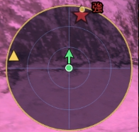

# AbysseanRadar (v0.6.1)

**An addon for FFXI (Windower 4) that estimates where an invisible Abyssean NM is and shows it on a radar or map.**

[日本語版 README](README.md)

Abyssean NMs are invisible. When you heal while holding the right jade, the game prints a direction and a distance in chat (Japanese client example: 「…南東の方向の約88Ym先に向かって光を発した。」, meaning roughly "it shone toward the southeast, about 88 yalms away"). This addon remembers each result together with your own position, combines several results taken from different places, and shows **the area where the NM probably is** on a circular radar or map.



> **Japanese client only.** The addon reads only the Japanese-client jade messages (it looks for `光を発した` and `Ym先`). The English-client message format has not been checked, so it cannot read them. The addon's own chat messages are in Japanese. If you play on the English client and want to help, please open an issue with a sample of the message.
>
> Confirmed in game (2026-10-17, Japanese client, Abyssea - Uleguerand etc.): position estimation, radar and map display / moving / zooming, right-click display switching, the chat notice when you get close, color and opacity settings, wav sounds, and the truth check after the NM appears.
> Not confirmed: the English client, a real fourth-stage ("violently") NM, and the wording for 16 directions (I have only seen 8).

---

## What it does

* **Estimates the NM's position from the healing results.** One result only gives one of 8 directions (45 degrees wide), so it is wide at first. After 3-5 results from different places, taken while moving closer, it narrows to within a few yalms.
* **Older measurements are trusted less, because NMs move.** The maximum speed is 1.5 yalms/s (change it with `//ar speed`). If the target seems to be moving, a small movement arrow is shown too.
* **Tracks each stage and each color separately.** The vibration wording (a little / a lot / powerfully / violently) gives the stage (small / large / strong / intense). It is shown next to the star as a kanji and the star color changes (small = light blue, large = orange, strong = red, intense = purple). Up to 3 are shown at once.
* **Can show a circular map with you in the center.** If you have the map of the zone, a map is shown instead of the radar (see below for preparing maps). North is up.
* **Tells you in chat when you get close.** "Getting close" at 30 yalms or less and "Very close" at 10 yalms or less. The distances can be changed. To get a sound, put your own `sounds/near.wav` and `sounds/close.wav` in place and run `//ar sound on` (off by default, optional).
* **Checks the answer.** When the NM appears, the addon compares the position of the nearby enemy in battle with its last estimate and prints the difference in chat.
* **Sends nothing to the game server.** It only reads the chat log and the coordinates of you and of nearby enemies through the Windower API. There is no code that reads or writes game memory or sends anything to the server, and it does not press keys or use abilities for you.

## Measured accuracy

The difference between the real position where the NM appeared and the last estimate:

| NM | Stage | Measurements | Error |
|---|---|---|---|
| Tammuz | 2nd | - | about 2 yalms |
| Chesma | 2nd | 3 | 1.4 yalms |
| Chione | 2nd | 9 | 2.8 yalms |
| Dawon | 3rd | - | 3.8 yalms |

The table is my own record. In every case the last measurement was taken within 20 yalms of the target. The jade reacts from far away (a reading of 224 yalms was seen). The first reading is wide (around +/-50 yalms), but it narrows when you get closer and measure again.

## Installation

1. Put the files of this repository in `addons/AbysseanRadar/` of Windower (the folder must be named `AbysseanRadar`).
2. In game: `//lua l AbysseanRadar`. To load it automatically, add `lua l AbysseanRadar` to `scripts/init.txt`.
3. Hold the right jade and heal at a distance where the position is shown, and the radar appears.

## How to use

1. In Abyssea, hold the right jade and heal. When a direction and distance appear, a star appears on the radar.
2. **Move to another place** and heal again. The ring around the star (the possible area) gets smaller.
3. The text box shows how well it is narrowed down: "error +/-N yalms = nearly exact / roughly / still wide". If it says "still wide", measure a few more times.
4. When you get close, it tells you in chat.

### Reading the screen

* **Green dot and arrow** = you and the direction you face
* **Star and kanji** = the estimated position of the NM and its stage (small / large / strong / intense). The color depends on the stage
* **Ring around the star** = the possible area. The smaller, the better it is narrowed down
* **Small yellow dots** (radar only) = what each measurement suggested
* **Small arrow** = the direction the target seems to be moving
* **Gold triangle** (radar only) = north

### Mouse controls

| Action | Effect |
|---|---|
| Left drag | Move the radar (map) |
| Wheel | Radar: change the range / Map: zoom in and out |
| Right click | Switch the display: your facing is up -> north is up -> map -> ... (in a zone without a map, only the first two) |

Clicks on the radar and map are not passed on to the game.

## Preparing maps (optional)

The map images are **not included**. They are the work of the authors of mappy and ffassist, and I could not confirm that redistribution is allowed. Please prepare them on your own PC:

1. From the mappy GitHub ([KenshiDRK/mappy--Kenshi-Version](https://github.com/KenshiDRK/mappy--Kenshi-Version)), download the repository as a ZIP and extract it. It contains a `Maps` folder.
2. Run `tools/convert_maps.ps1` in PowerShell:

   ```powershell
   powershell -ExecutionPolicy Bypass -File tools\convert_maps.ps1 -Source "C:\...\mappy--Kenshi-Version-master\Maps"
   ```

   You can limit the zones with hexadecimal zone numbers, for example `-Zones fd,fe`. Without it, the 10 Abyssea zones are converted. If you need maps for other zones, such as field zones, add their zone numbers to `-Zones`. One zone makes 4096 tiles, so converting all zones is not the default. To convert every zone, add `-Zones all` (about 300 zones, about 1.2 million files, about 1.5 GB, around 20 minutes).
3. Map tiles (8x8 pixel PNGs) and the alignment data (`map.ini`) go into the `maps/` folder. If `//ar status` shows "地図: オン (このゾーン: あり)" (map: on, this zone: yes) in game, it works. (The addon's own messages are in Japanese.)

Windower's `images` has no way to crop an image, so the map is split into small tiles and only the visible tiles are laid out. The overflow is hidden with a ring image around the edge. The higher the zoom, the more tiles overflow, so the ring gets thicker (it is chosen automatically within the range where nothing is cut off, and the maximum zoom is kept in that range too). The image looks a bit coarser.

## Commands

`//ar` (or `//abyradar`)

| Command | What it does |
|---|---|
| `//ar hud [on\|off]` | Show / hide the radar (map) |
| `//ar mode [north\|heading]` | Radar orientation: north up / your facing up (default) |
| `//ar map [on\|off]` | Whether to use the map |
| `//ar mapsize <diameter>` | Diameter of the map circle in pixels (default 190) |
| `//ar mapzoom <scale>` | Map zoom (kept within the range where nothing is cut off) |
| `//ar mapalpha <0-255>` | Map opacity (default 200) |
| `//ar range <yalms>` | Distance represented by the radar radius (default 80) |
| `//ar size <px>` | Radar size |
| `//ar alpha <0-255>` | Opacity of the radar background |
| `//ar color <stage> <r> <g> <b>` | Stage color. `//ar color reset` restores the defaults |
| `//ar notify [on\|off]` | Chat notice when you get close |
| `//ar near <m>` / `//ar close <m>` | Distances for "getting close" / "very close" (default 30 / 10) |
| `//ar sound [on\|off]` | Notice sound (when `sounds/near.wav` and `sounds/close.wav` exist) |
| `//ar speed <yalms/s>` | Maximum speed an NM may move (default 1.5) |
| `//ar clear` | Clear the tracking |
| `//ar status` | Show the current tracking and settings |
| `//ar truth` | Target the NM that has appeared and type this to print the difference between its real position and the estimate (truth check) |
| `//ar last` | Show recent records |
| `//ar log [on\|off]` | Turn the record (`data/ping.log`) on / off |

The stage for `//ar color` is written with the kanji the addon uses (小 / 大 / 強 / 激 = small / large / strong / intense).

## About the record

`data/ping.log` records the jade and appearance chat lines (including the visitant timer and glow lines) together with your coordinates, facing and time, for researching the message format and checking accuracy. It is on by default. **It is saved only on your own PC and is never sent anywhere.** You can stop it with `//ar log off`.

## Notes

* The NM's position is an **estimate**. Directions are rounded to 8 directions, so the error depends on the number and places of measurements.
* The estimate assumes the NM does not move much and only allows for the maximum speed. A long time after the measurement, the estimate drifts.
* The map alignment values come from mappy's `map.ini`. In some zones the map may be slightly off.
* Third-party tools, Windower included, are prohibited by the FFXI Terms of Service. I cannot guarantee that this addon is allowed or that it will not be detected. Use it at your own risk; the author accepts no responsibility for any consequences.

## Credits and license

* Code and images (`images/`): MIT License (`LICENSE`)
* The map images and the alignment data (`map.ini`) belong to the authors of mappy and ffassist. **They are not included in this repository.**
* It uses Windower 4's `config`, `texts` and `images` libraries.

## Feedback

A one-line "it works" is welcome too. With a GitHub account you can post from [Issues](../../issues/new/choose).
